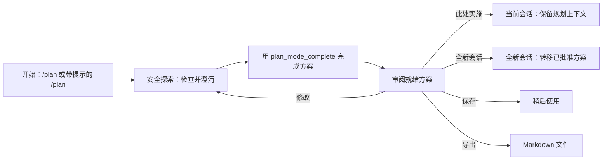
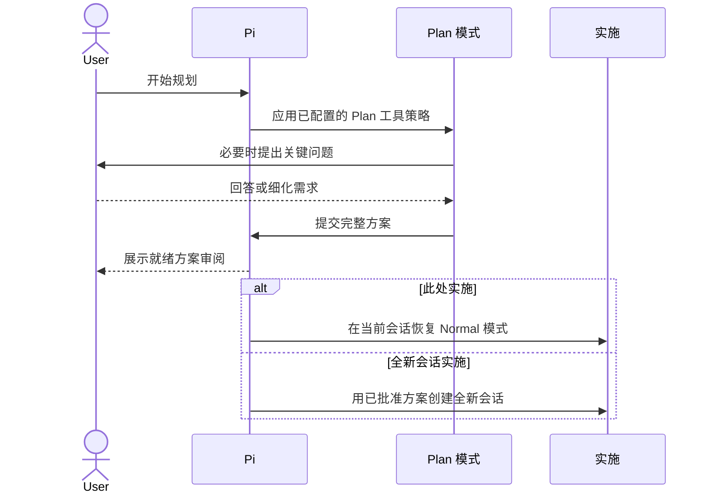

# 🧭 pi-plan-mode-autoswitch — Pi 改代码之前先出方案

**语言：中文 | [English](./README.en.md)**

[](https://www.npmjs.com/package/pi-plan-mode-autoswitch) [](https://pi.dev) [](./LICENSE)

> **Fork 说明**：本包是 [`@narumitw/pi-plan-mode`](https://www.npmjs.com/package/@narumitw/pi-plan-mode) v0.59.2 的独立 fork，新增了可选的 **Plan 边界自动切换模型** 功能。上游行为全部保留；新功能为可选开启，由三个新设置项控制：`autoSwitchModel`、`planModel` 和 `normalModel`。

用类 Codex 的 `/plan` 模式探索代码库、澄清关键问题，并在 Pi 动手改文件之前批准一份可直接实施的方案。

## ✨ 功能

- 通过 `/plan`、`/plan start` 或 `/plan <prompt>` 启动并管理 Plan 模式。
- 阻断修改类工具、非激活辅助工具和不安全的 shell 形式，同时保持辅助工具 schema 稳定。
- 用结构化问题澄清重要歧义，用显式完成动作产出可决策的方案。
- 在实施、导出、保存、继续规划或丢弃之前，先审阅完整方案。
- 在当前会话或全新的关联会话中，带着已批准的方案实施。
- 为全新实施配置持久化或一次性的目标模型与思考深度选项。
- 可选在 Plan 模式开始或结束时切换会话模型。
- 跨 resume 与压缩恢复 Plan 状态和一份已保存方案。
- 可配置 Plan 工具白名单、已审阅的 shell 命令、用户信任的子命令、导出路径、方案再注入、快捷键与思考深度。
- 向状态栏发布状态，并以匿名方式与 Workflow Mutex Protocol v1 参与者协作。

## 📦 安装

本版本要求 Pi 0.80.6 或更新。
Windows 上的原生 PowerShell 工具支持要求 Pi 0.84.3 或更新；更早的 Pi 版本会省略该可选项并沿用现有 Plan 策略。

```bash
pi install npm:pi-plan-mode-autoswitch
```

不想永久安装，可先试用：

```bash
pi -e npm:pi-plan-mode-autoswitch
```

在仓库根目录本地构建并试用：

```bash
npm install
npm run build
pi -e .
```

本包声明了 `dist/index.ts`，因此本地未构建的检出要先构建，Pi 才能加载包目录。
只从你信任的来源安装，因为 Pi 扩展会以 Pi 的权限运行。

## 🚀 快速开始

运行 `/plan` 打开感知状态的菜单，然后启动 Plan 模式，让 agent 检查并设计这次改动。
如果第一次规划请求已经明确，直接用 `/plan <prompt>`。

## 🗺️ 工作原理

Plan 模式让探索与实施分处一道显式审阅边界两侧：



规划期间，agent 可以检查项目并提出重要问题，但 Plan 模式会阻断编辑类工具和不安全的 shell 形式。只有方案完成、并且你选择交接方式之后，才开始实施：



## 💬 命令

| 命令 | 作用 |
| --- | --- |
| `/plan` | 启动或管理规划、审阅方案，或选择同会话/新会话实施。 |
| `/plan start` | 进入 Plan 模式，不发送模型消息。 |
| `/plan <prompt>` | 用提示开始规划，或在已激活时发送后续请求。 |
| `/plan tools` | 选择仅本会话生效的工具策略，然后启动；取消则不做任何更改。 |
| `/plan show` | 显示已存储的方案，不启动模型回合。 |
| `/plan finalize` | 要求当前规划者收尾，或提出最后一个关键问题。 |
| `/plan implement` | 在本会话实施已完成或已保存的方案，不弹选择器。 |
| `/plan save` | 在本 Pi 会话中保存就绪方案并退出 Plan 模式。 |
| `/plan settings` | 打开与菜单中相同的 Plan 设置页。 |
| `/plan export [path]` | 把就绪、已保存或进行中的实施方案写成 Markdown。 |
| `/plan exit`（别名：`off`） | 退出 Plan 模式并丢弃其就绪方案，或清除已保存/进行中的方案。 |

所有路由同时支持 TUI 和 RPC。
打印模式和 JSON 模式会拒绝菜单、`tools` 和 `settings`；已存储方案的显示与实施还有[额外的模式限制](#-规划与实施)。
精确匹配子命令词会命中对应路由，其他文本都算规划提示，所以 `/plan start a migration` 会发送提示而不是拒绝尾部文本。
没有启动参数。

状态变更类转换需要空闲回合；规划一旦开始，工具选择即被锁定。
`show`、`save`、`export` 和 `implement` 需要有适用的已存储方案；`finalize` 需要 Plan 模式处于激活状态。
导出默认写到已配置的目标（未配置时为 `PLAN.md`），从不覆盖已存在的目标，且只有导出就绪方案时才会退出 Plan 模式。
工具选择、忙态恢复、路径处理和导出取消见 [命令流程](./docs/command-workflows.md)；在允许自定义工具前请先阅读[安全与隐私](#-安全与隐私)。

## 🔒 安全与隐私

Plan 模式激活期间，策略会阻断内置编辑类工具，并要求 agent 不要编辑文件或实施改动。
它应当先探索，当某个偏好或取舍会实质影响方案时，用结构化问题提问。
请在激活之前配置持久化默认值或单次流程的工具覆盖；激活中与就绪状态会锁定这些控件。

Plan 模式在扩展加载时注册 `plan_mode_question` 和 `plan_mode_complete`，且自身从不改变它们的激活状态。
若另一个激活中工具策略隐藏了它们，Plan 的启动或恢复会失败，而不会放宽该策略。
默认情况下，Plan 策略允许 `read`、受限 `bash`、受限 `powershell`、`grep`、`find`、`ls` 等安全的激活中内置工具。
可选的原生 `powershell` 工具在自动 Plan 策略启动时必须处于激活状态（例如通过 Pi 的 Windows `defaultTools` 设置），除非其名称被显式保留用于首次请求解析。
名为 `edit`、`write` 或 `update_plan` 的工具以及被取消勾选的工具，即使其 schema 仍然可见，也会在执行时被阻断。
已审阅核心策略之外的工具——包括原生 MCP 工具、原生编排、扩展和自定义工具——默认被拒绝；只有在接受风险时才在启动前显式允许它们的名称。
`readOnlyHint` 之类的 server 注解只是未经验证的提示，不等于许可或安全保障。
例如，可通过 `/plan tools` 或 `defaultPlanTools` 在下一次流程前选择 `mcp__docs__read`、`mcp__firecrawl__firecrawl_scrape` 或 `lsp_diagnostics`。

直接工具和 `model-only` 工具必须在 Pi 中激活；`model-only` 工具不能被其他工具调用。
已注册的 `codemode` 和 `deferred` 工具无需直接激活即可选择，并可通过 Pi 的嵌套工具管线运行。
MCP 的 `codemode-deferred` 遵循其公开的 `deferred` 暴露方式。
需要时请单独选择 `codemode` 或 `tool_search` 之类的编排器：允许它并不授权其被调用方，选择某个 MCP 工具也不会启用它的编排器。
Pi 的 `tool_search` 可以自行声明工具，但声明不会让未选择的名称进入冻结的 Plan 策略。
每一次嵌套调用仍然单独受控，包括编辑和受限 shell 的限制。
隐藏工具即使被选中或被列为激活也不可用；不支持的暴露方式和不可用的策略元数据都会按失败关闭处理。
已注册但未激活的直接工具、未注册工具、被阻断的核心工具和未选择的工具会给出各自不同的拒绝说明。
在后续被停用之前准入的工具，可以在当前流程中重新激活并复用，无需重启。
在它们可见之后，Plan 专属辅助工具在 Normal 模式下仍可见，但除非 Plan 模式拥有当前活动流程，否则其处理器和 `tool_call` 策略会拒绝调用。

受限 `bash` 使用失败关闭的 Bash 策略，即使某个扩展覆盖了规范的 `bash` 工具名同样生效。
它接受常见检查类命令、只读 Git 与 npm 查询、完全由已接受命令组成的管道和命令列表，以及 `npm test`、`npm run typecheck`、`cargo test` 等选定检查。
对 `rg`、`grep`、`git grep` 这类检查命令允许大小写不敏感的 `-i`；而 `-i` 表示原地编辑的命令（例如 `sed`）仍被阻断。
它也接受不带参数的 `hostname`，以及使用已审阅显示、过滤、模块和服务参数的本地 Windows `tasklist` 查询。
已审阅的 Git 检查可以把 `--no-pager` 放在被接受的子命令之前。
它也可以在被接受的子命令前放置一个或多个完整的 `-C <path>` 参数对，但前提是每个路径都是 `.` 或当前 Pi 工作目录本身。
其他目标会被拒绝，以防止 `git -C` 引入另一个仓库的可执行配置、钩子、过滤器、签名程序或惰性拉取远端。
它会拒绝输出/输入重定向、shell 展开、命令替换、子 shell、后台任务、不完整或会切换目录的 `-C` 参数对、其他 Git 全局选项、Git config 覆盖、修改类标志、依赖变更、编辑器和未知命令。

受限 `powershell` 使用独立的失败关闭 PowerShell 策略，即使某个扩展覆盖了规范的 `powershell` 工具名同样生效。
它接受 `Get-ChildItem`、`Get-Content`、`Get-Item`、`Get-Location`、`Resolve-Path`、`Select-String`、`Test-Path`、`Measure-Object`、`Sort-Object`、`Format-List`、`Format-Table`、`Out-String`、`Write-Output` 等规范检查类 cmdlet。
它接受带已审阅静态选择器的本地 `Get-Process` 和 `Get-Service` 查询，同时拒绝远程参数和对象输入参数。
它也接受与受限 Bash 相同的已审阅 `git` 和已配置的 `gh` 查询，包括完全由已接受命令组成的管道和分号分隔的命令列表。
它会拒绝重定向、变量、命令替换、脚本块、调用操作符、类型或方法表达式、停止解析标记、多行输入、非 ASCII 引号、别名、修改类 cmdlet 和未知命令。
请使用规范 cmdlet 名称，因为 PowerShell 别名被有意排除在已审阅策略之外。

被拒绝的已解析命令列表或管道会指明第一个被阻断的命令段；语法畸形或不受支持的 shell 语法则会回显完整提交内容。
测试和构建仍可能写入被忽略的缓存或构建产物，也可能执行项目定义的钩子；只有在仓库可信时才启用或调用它们。
两种受限 shell 策略都能降低风险，但不提供操作系统沙箱或保密边界。
配置的 `safeSubcommands` 匹配只信任它自己解析出的命令段和参数；相邻命令段必须各自通过策略，解析器不支持的语法仍被阻断。
受信任的命令依然可能以 Pi 的权限修改数据或执行代码；信任边界与迁移指引见 [safe shell 子命令](./docs/settings.md#safe-shell-subcommands)。

## 🧭 规划与实施

`plan_mode_question` 沿用 Codex 的 `request_user_input` 模式：agent 可以提出 1-3 个精炼问题，每题都有有意义的选项和自由输入的 Other 路径。
在 TUI 模式下，单个问题会把标题显示为普通弱化文本，确认预设或自定义答案后立即提交，且不显示标签页、Review 或问题导航控件。
提交单个预设答案前可用 `n` 补充一条可选备注。
两个或三个问题时，一次显示一个问题，带问题标签页和最后的 Review 标签页。
用 Tab、Shift+Tab、左、右访问任意问题或 Review，包括尚未回答的后续问题。
用上、下选择选项，回车记录并前进，或按 `n` 记录高亮选项并打开其可选备注编辑器。
在已回答的条目上再次按 `n` 可编辑或清除备注。
重新访问某个问题可以替换其答案；更改所选选项会清除其原有备注。
Review 会列出所有答案与备注，阻止不完整的提交，并要求回到该问题才能修改答案或备注。
自定义答案与备注在工具结果中保留原始提交文本，而终端渲染会做净化处理。
在 TUI 模式下，通过 Pi 的 `ctx.ui.setEditorComponent()` 注册的自定义编辑器也会在独立实例中处理答案和备注编辑，不改动主提示草稿。
该编辑器激活期间由它接管 Escape 与提交键；Ctrl+C 仍然取消问题。
编辑器提交的值会被保留，包括它有意进行的任何空白规范化。
没有自定义编辑器时，既有的编辑与取消行为不变。
TUI 会拒绝任一字段超过 4,000 字符的输入，而不是截断。
RPC 保持既有的顺序 `select` 和 `editor` 对话框，因为 Pi RPC 无法渲染自定义 TUI 组件。
如果你取消，或者没有可用的交互界面，agent 应当提出一个精炼的纯文本问题，或者只在明确说明低风险假设的前提下继续，而不是过早产出最终方案。

Pi 按工具名识别工具。
启动前的选择器会存储已接受的会话策略名，并从 Pi 元数据展示每个生效工具的来源与可用性，包括原生内置与扩展注册。
已选名称只有在生效工具已注册、通过其暴露方式可用、并且在流程首次绑定提供商的上下文中被策略允许时，才能在 Plan 模式运行。
白名单在该边界冻结，重载、恢复或树导航之后恢复时不接受新名称。
之后才注册或首次可用的工具要等下一个 Plan 流程；已准入的可调用工具即使后续才向模型声明，也保留其既有准入。
如果某个扩展用同名覆盖内置工具，Pi 会为该名暴露生效工具，选择器也会展示其来源。

只有在 agent 已澄清可发现的事实和高影响的用户决策之后，才应当给出完整的 Plan 模式答复。
agent 必须单独调用 `plan_mode_complete({ plan })` 作为最后动作，并传入完整的 Markdown 方案。
该工具拒绝空或纯空白方案，以及超过 50,000 个 JavaScript 字符的方案；它不会截断。
其可见结果包含完整方案，带版本的结果详情让扩展能从活动会话分支安全恢复它。

`plan_mode_complete` 使用 Pi 的 `terminate: true` 提示。
终止是尽力而为：如果模型把它放进并行工具批次，只有当所有已定稿的兄弟工具也终止时，Pi 才会提前终止该批次。
因此提示要求完成调用必须独立且最后执行。
扩展刻意不会从“我将呈现方案”这类措辞推断完成，普通的调研或澄清回合也绝不会触发自动重试。
`/plan finalize` 及其精确规范的收尾提示是显式的恢复请求。
如果其中某个请求正常结束但既没有有效结构化问题也没有完成方案，Plan 模式会等待 `agent_settled`，并用更强的工具指引重试一次。
有效问题、被接受的完成、用户取消、显式退出、流程被取代、重载、会话替换或关闭都会取消这次重试。
第二次仍只输出散文时，Plan 模式保持激活，在交互模式下告警，并需要再次显式调用 `/plan finalize`。

旧版会话和模型仍可能提交一个非空的 `<proposed_plan>` 代码块，标签各占一行。
该兼容路径依然可用，但不是主要工作流。
空的、畸形的、未闭合的或多个旧版代码块会让 Plan 模式保持激活并产生警告。

完成之后，交互界面可用时 `/plan` 会打开就绪操作。
同一个扁平菜单会展示 **此处实施** 和 **全新会话实施**，说明每个选择使用哪些对话上下文，并预览所选的 **方案再注入** 策略。
**此处实施**（以及兼容路由 `/plan implement`）会追加 Normal 契约、解除 Plan 运行时策略、记录再注入设置，并带着完整的规划对话和工具调用在当前会话开始实施。
**全新会话实施** 会在替换前打开一个设置页。
其可搜索模型列表在配置了会话模型作用域时对该作用域做快照，否则使用 Pi 当前可用的模型，并展示每个提供商、模型 ID 和友好名称。
Pi 0.80.6–0.82.1 不向扩展暴露会话模型作用域，因此这些版本上列表使用当前全部可用模型。
一次性提供商和模型标识各限 512 字符；过长的自定义标识在替换源会话之前就会被拒绝。
模型与思考深度两行以持久化的 **Fresh model** 和 **Fresh thinking** 默认值为起点；任一设置缺省时，它们显示规划会话的当前值并标注 **与规划相同**，且彼此独立地带入全新会话。
固定的思考深度选项为 `off`、`minimal`、`low`、`medium`、`high`、`xhigh` 和 `max`。
返回上一级会保留该菜单内的草稿，而关闭再打开菜单则恢复两个持久化默认值。
如果配置的模型不在当前作用域或已不可用，该行会报告回退并使用 **与规划相同**，但不删除已存偏好。
已保存方案菜单保留其直接的新会话操作，不带可选项行，并应用同样的持久化默认值与回退。

从该设置页启动会等待源会话空闲，重新解析并认证显式模型，创建一个以持久化源为父级的新会话，并转移完全一致的已批准方案，而不复制规划消息、工具结果或压缩/分支摘要。
目标会话在其首次提供商请求之前消费这些一次性选择：先应用显式模型，再应用显式思考深度。
在应用这些选择期间到达的并发提示会被排为跟随 kickoff 提示的后续请求。
如果持久化消费阻塞了 kickoff，交接会报告部分启动，并把对话历史提示恢复到编辑器，而不是报告成功。
只改模型会保留规划的思考深度；只改思考深度会保留规划的模型。
如果 Pi 钳制了不支持的思考深度，扩展会报告实际生效的等级。
如果所选模型在源预检后消失或失去认证，目标会报告这一竞态、消费该意图而不在之后重试，并继续使用其默认模型。
目标仍会加载其常规的 `AGENTS.md`、技能、项目资源和扩展。
选择 **导出方案…** 会询问目标位置、写出方案、追加 Normal 契约、恢复继承的思考深度，并在不启动模型回合、不改变激活工具的情况下退出 Plan 模式。
选择 **稍后保存**（或运行 `/plan save`）则在退出 Plan 前把一份方案存入当前 Pi 会话。

当恢复后的活动 Plan 流程在该恢复会话中尚未运行过 `/plan` 就已完成时，自动菜单无法获得 Pi 仅命令式的会话替换能力；此时选择新会话会请你重新打开 `/plan`，那里有同样的操作。
成功的新会话交接不会删除或消费源规划会话。
之后恢复它可以再次检查或再次交接就绪/已保存方案；这种刻意的重复正是目标端工作被放弃时的恢复路径。
内存会话会创建一个未链接的新会话，因为不存在父文件。
Esc、Ctrl+C、菜单销毁、源替换/关闭、模型或认证失败，或替换前被其他扩展取消，都会保持源方案不变。
在 **关闭 — 仅对话历史** 下，目标在其初始用户提示中收到完整方案，且不持久化活动方案状态。
存在一次性运行时选择时，只持久化该临时非模型状态，并在首次请求前移除。
如果该移除无法持久化，请求不会发出，待会话持久化可用后可重试。
如果该 kickoff 失败，完整请求会留在目标编辑器中，源会话仍可恢复。
在任一保障方案策略下，目标会在 kickoff 前持久化活动方案状态。
如果保障方案的持久化失败，完整请求会放入目标编辑器，源会话仍可恢复。
如果保障方案的 kickoff 失败，目标会保留活动方案：发消息继续、用 `/plan exit` 清除，或恢复父级规划会话。

已保存方案会显示为 `plan saved`，在该会话内跨重载、恢复、分支内 fork 和压缩都保持可用。
它不会自动过期，不会进入新会话，也不参与普通的模型上下文。
打开 `/plan` 可以显示、此处实施、全新会话实施、导出、打开设置或清除它；`/plan show`、`/plan implement`、`/plan export [path]`、`/plan exit`/`off` 在 TUI 和 RPC 中保留各自的直接路由。
全新会话实施会在替换会话前检查空闲状态、所选模型和认证；此处实施保持其既有预检行为。
在已保存方案被实施或清除之前，用 `/plan start`、`/plan <prompt>` 或 `/plan tools` 启动另一个流程会被阻断，因此这个唯一的保存槽位绝不会被静默覆盖。
恢复该会话后方案仍保持保存状态；打开 `/plan` 即可审阅、实施、导出或清除。
取消或实施预检失败不会改变它。

纯文本打印和 JSON 模式无法显示裸 `/plan` 菜单，会在改变状态之前拒绝该路由；直接无提示激活请用 `/plan start`，带提示开始规划请用 `/plan <prompt>`。
`/plan tools` 同样在改变状态前拒绝，因为其分阶段选择器需要 TUI 或 RPC。
这些模式可以用 `/plan export [path]` 导出任意已存储方案，用 `/plan save` 保存就绪方案，用 `/plan exit` 或 `/plan off` 清除。
导出成功可通过生成的文件观察到；导出就绪方案还会退出 Plan 模式，而已保存与实施中的状态保持不变。
目标已存在或方案缺失会使命令失败且不改变状态。
这些模式在改变状态前拒绝已保存方案的显示与实施，因为 Pi 既不提供可打印的自定义消息输出，也没有被确认的扩展触发回合；请在 TUI 或 RPC 中恢复会话以显示或实施它。

两条实施路径都会在其目标中应用当前的 **方案再注入** 策略。
默认的 **关闭 — 仅对话历史** 不创建活动方案状态，也不注入隐藏的方案上下文。
此处实施会发送 `Implement the plan.`，并把已接受的方案留在普通规划历史中。
全新会话实施，或在此处实施已保存方案，会把完整方案放进一个普通的初始用户提示，因为此时并不存在可靠的规划对话。
之后的模型调用依赖 Pi 正常的对话历史和压缩行为。
**贯穿首次实施运行** 会在该次运行期间保障完全一致的方案，包括重试、压缩重试和排队的续跑，然后在 `agent_settled` 时清除活动方案状态。
**直到手动清除** 会在后续回合、恢复以及手动或自动压缩期间保障完全一致的方案，直到 `/plan exit` 或流程被取代。
保障类策略在原始实施交接仍然可用时不产生重复上下文块，而在该交接被压缩掉之后注入一份隐藏的规范副本。
再注入在模型上下文中最多占用既有的 50,000 字符方案上限。
清理绑定到匹配的那次实施，因此更早的回合结束不会清除更新的交接。

保障方案激活期间，`/plan show` 显示已接受的方案。
交互式 `/plan` 提供显示、导出方案…、设置、开始新方案和清除；`/plan exit` 和 `/plan off` 是直接的清除路由。
设置更改绝不会改变活动的保障方案实施已捕获的策略。
首次运行的自动清理会在触发实施已收到完整方案之后，移除活动状态和后续注入的上下文。
启动新的 Plan 模式流程或实施方案的替代版本会取代活动的保障方案。
在 **直到手动清除** 下，扩展刻意不会从助手散文或 agent 结束推断完成，因此方案不再适用时请手动清除活动方案。
在 **关闭 — 仅对话历史** 下，实施消息保持为普通对话历史，也没有可供 `/plan exit` 移除的活动方案。
在实施前选择“留下”会保持方案就绪。
修改反馈会开启另一个 Plan 模式回合，并清除上一个可实施方案，直到收到更新后的完成。
对于仅澄清的后续请求，agent 会回答并重新提交完全相同的完整方案，使其保持可实施。
在保存或实施之前，exit/off 会丢弃就绪方案，并把它从后续非 Plan 模型上下文中的完成结果里移除。

Plan 模式启用期间，扩展还会向 Pi 状态栏发布一条紧凑状态。
配合 `@narumitw/pi-statusline`，它会出现在扩展状态区：

- `plan active`：Plan 模式已启用，仍在收集上下文或起草方案。
- `plan ready`：已完成的方案已存储，等待你实施、导出、保存、继续规划或退出 Plan 模式。
- `plan saved`：一份已完成的方案存储在当前会话的模型上下文之外，等待你实施或清除。
- `plan implementing`：已接受的完全一致方案在 **贯穿首次实施运行** 或 **直到手动清除** 下得到保障。

你也可以直接退出。
实施之前，直接退出会丢弃最新的候选方案；方案处于保存状态时，它会清除该已保存方案。
在保障方案实施期间，它会从后续模型调用中移除原始实施交接和扩展的规范活动方案块；更早由 Pi 生成的压缩摘要仍可能描述此前的工作：

```text
/plan exit
```

## 🧱 缓存稳定的模式转换

Plan 和 Normal 请求共享同一份只追加的对话。
扩展在第一个 Plan 提示前追加一条隐藏的、模型可见的、带版本的 Plan 契约，在其后的第一个 Normal 或实施提示前追加一条 Normal 契约。
普通的线性回合不会重写或复制这些契约。
Plan 契约解释原生工具的按需启用与逐调用嵌套强制；这段措辞只影响未来的 Plan 转换，不会重写已有的转换消息。
**此处实施** 按顺序保留 Plan 对话、结构化问题、工具调用、完成证据和 `Implement the plan.` kickoff。
**全新会话实施** 是隔离路径，只把已批准方案和 Normal 契约转移到一个关联会话。

`context` 钩子会过滤重复的旧版 `plan-mode-context` 产物，但保留当前的转换消息。
如果压缩移除了生效的转换，钩子会在一个确定的保留历史边界插入一份规范兜底。
重复的 transform 会保持该兜底原位，而不会把它移到最新回合。
未激活的旧版状态条目不会注入 Normal 契约，因此从未进入 Plan 模式的会话在恢复或重载后保持其普通上下文。
手动 `/tree` 导航会恢复分支持有的 Plan 状态并选择匹配的契约，既不导航也不添加分支摘要。
Pi 会在 `/tree` 中列出隐藏的转换消息；Plan 模式会拒绝这些内部目标，请选择相邻的对话条目。

Plan 模式只注册一次 `plan_mode_question` 和 `plan_mode_complete`，并在 Normal、Plan、就绪、实施和恢复流程中保持其名称与定义稳定。
辅助工具可见并不代表 `/plan` 已激活，它们的描述也不涵盖普通规划、`writing-plans` 技能、路线图、清单和计划文件工作。
只有最新的活动 Plan 契约授权这两个辅助工具；未激活或过期的调用会失败，既不接受方案也不打开问题 UI。
Plan 模式不会放宽受限的激活中工具策略；所需辅助工具不可用时，启动或恢复会失败。
稳定的 schema 能保留可缓存的前缀，但无法保证命中，因为提供商序列化、缓存生命周期、最小前缀长度、实现细节和会话亲和性仍属外部因素。

默认的 `thinkingLevel: "inherit"` 避免了 Plan 专属的推理参数变更。
固定 Plan 思考深度依然受支持，但修改推理参数可能阻止提供商侧的状态复用，即使提示和工具 schema 保持稳定。

## 🤝 流程共存

Plan 模式可独立安装，在没有其他协议参与者时保持其独立行为。
在已表征的 Pi `0.84.2` 运行时上，它会参与匿名的 `workflow:mutex:v1` `agent-workflow` 组。
规划激活期间、已就绪方案等待审阅期间、以及修改进行期间，它都持有该组。
已保存方案以及 Plan 交接之后的普通实施不持有该组。

每一次从非激活状态启动，都会在异步预检之后、且在改变 Plan 状态、持久化、提示、工具、思考深度、队列或状态之前，执行最后一次同步准入。
如果另一个参与者处于激活状态，TUI 和 RPC 会显示匿名警告，提示有其他流程正在运行。
打印模式和 JSON 的直接路由会在变更前抛出同样的匿名错误。

启动菜单、已选工具、快捷键、实施中的 **开始新方案** 以及恢复激活都使用同一个准入边界。
被拒绝的已选工具启动不会保存其草稿选择。

恢复的活动 Plan 状态会在恢复受限工具、思考深度、状态或模型钩子之前先获取锁。
如果恢复时忙，Plan 模式保持未运行，不动持久化历史和激活工具，并要求在其他流程结束后稍后重载或显式重新启动。
全新会话实施预检期间取消规划会话，会保留源 Plan 及其所有权。
成功替换会话依赖源会话关闭来清理并释放；目标端的普通活动实施不获取 Plan 互斥锁。

该共存保证是协作式的，仅在每个竞争者都实现 v1、运行在已表征的 Pi 运行时并共享同一事件总线与会话管理器标识时成立。
v1 之前、混合版本、未参与、fork 或其他未表征的对端不支持互斥。
Plan mode 不会识别、检查、配置、启动、停止或依赖其他扩展。
与 Goal 的保证共存要求在已表征的 Pi `0.84.2` 运行时上，`@narumitw/pi-goal` `0.53.0` 或更新，且本包 `0.52.0` 或更新。

| 安装组合 | 支持情况 |
| --- | --- |
| Plan mode 且无其他流程参与者 | 独立行为受支持 |
| Plan mode `>=0.52.0` 与 Goal `>=0.53.0`，Pi `0.84.2` | Workflow Mutex v1 共存保证 |
| 任一包低于其下限，或使用其他 Pi 运行时 | 仅独立行为；不支持互斥 |

## 🛠️ 工具

- `plan_mode_question` 最多提出三个结构化问题，支持可选的答案备注，可直接提交单个答案，并在 TUI 提交前审阅多个答案。
- `plan_mode_complete` 记录完整的已批准 Markdown 方案，并在单独调用时终止规划回合。

## ⚙️ 设置

运行 `/plan settings`，从非激活的 `/plan` 菜单打开 **设置**，或编辑 `<getAgentDir()>/pi-plan-mode.json`（通常是 `~/.pi/agent/pi-plan-mode.json`）。
该可选文件在会话开始时读取并监听变更；只有显式保存才会创建它。

```json
{
  "thinkingLevel": "inherit",
  "implementationPlanRetention": "clear-on-start",
  "defaultImplementationModel": {
    "provider": "anthropic",
    "modelId": "claude-sonnet-4-5"
  },
  "defaultImplementationThinkingLevel": "high",
  "autoSwitchModel": true,
  "planModel": { "provider": "anthropic", "modelId": "claude-opus-4-1" },
  "normalModel": { "provider": "anthropic", "modelId": "claude-sonnet-4-5" },
  "defaultPlanExportPath": "PLAN.md"
}
```

默认情况下，Plan 模式继承思考深度，允许激活中的安全内置工具，全新会话实施使用规划所用的模型与思考深度，导出到 `PLAN.md`，并在实施开始后依赖普通对话历史。
除非启用 `autoSwitchModel`，否则 Plan 边界的模型切换是关闭的。
快捷键默认禁用；启用、修改或移除后需 `/reload` 或重启 Pi 才生效。
在此之前，当前快捷键绑定保持不变。
设置保存会作用于后续流程；激活中的实施保留其已捕获的再注入策略。
导出目标会立即影响下一次导出。
未激活的内置 `grep`、`find` 和 `ls` 必须[在 Pi 设置中启用](./docs/settings.md#enable-inactive-built-in-search-tools-in-pi)；Plan 策略只授予执行许可。

> [!WARNING]
> `safeSubcommands` 是仅 JSON、按命令段生效的信任覆盖，不是只读白名单。
> 它信任匹配的命令及其参数，但不信任尾随命令或重定向等解析器不支持的语法。
> 只为你完全信任的命令和仓库配置它；受信任的参数仍可能导致修改或代码执行。

保存在单个 Pi 进程内有序进行，会保留未知字段并原子发布；不同 Pi 进程之间仍可能竞争。
无效设置不会被改动，并会让设置页变为只读；会话启动时的失败会使用安全默认值。

全部可接受取值、工具策略解析、再注入选择、自动模型切换、快捷键配置、shell 覆盖示例和旧文件迁移，见 [设置参考](./docs/settings.md)。

## 🧠 类 Codex 行为

本扩展把 Codex 的 `ModeKind::Plan` 行为映射到 Pi 的扩展 API：

- Plan 模式是对话式协作，不是 TODO 或进度追踪。
- `/plan <prompt>` 先进入 Plan 模式，再提交提示。
- agent 用 `plan_mode_question` 处理重要偏好，并用独立的 `plan_mode_complete` 调用收尾，而不是靠散文判断。
- `update_plan` 被阻断，直到显式的实施边界恢复 Normal 模式。
- 默认的 `clear-on-start` 策略使用对话历史；`clear-after-first-run` 和 `keep` 增加完全一致方案的保障。
- 只追加的 Plan 与 Normal 契约保持辅助工具 schema 稳定，但 Pi 的工具策略属于风险降低，而非 Codex 沙箱级强制。

## 🗂️ 包结构

```text
.
├── src/                               # 策略、问题、设置与交接模块
│   ├── index.ts                       # 精简的 Pi 入口
│   └── plan-mode.ts                   # 规划策略与实施交接
├── dist/                              # 生成的 Jiti 运行时
├── scripts/
│   ├── build-runtime.mjs              # 运行时构建器
│   └── runtime-builder.mjs            # 共享的 esbuild 拆分 Jiti 辅助
├── docs/                              # 发布的参考文档
└── test/                              # 行为与生命周期覆盖
```

生成的运行时由 `src/index.ts` 构建，不会反向导入 `src`。

## 🔎 关键词

Pi extension, Pi coding agent, plan mode, Codex-like plan mode, AI coding workflow, read-only planning, implementation plan, automatic model switching, autoswitch.

## 📄 许可证

MIT。

见 [`LICENSE`](./LICENSE)。
