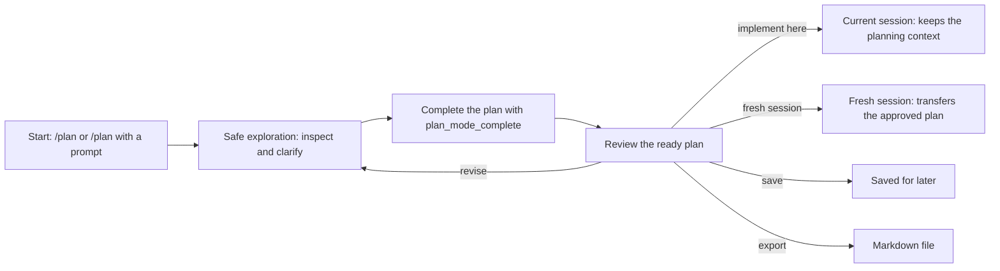
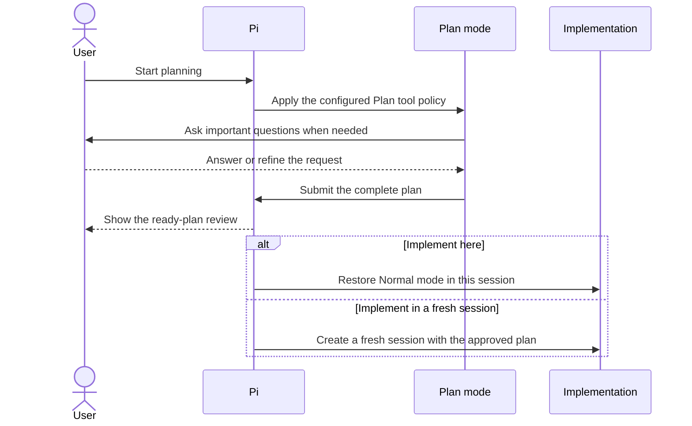

# Plan command workflows

[Back to README](../README.en.md#-common-commands)

- [Start and choose tools](#start-and-choose-tools)
- [The planning round](#the-planning-round)
- [Review the ready plan](#review-the-ready-plan)
- [Compare plan versions](#compare-plan-versions)
- [Implement the plan](#implement-the-plan)
- [Save for later](#save-for-later)
- [Export Markdown](#export-markdown)
- [Busy transitions and recovery](#busy-transitions-and-recovery)
- [Non-interactive modes](#non-interactive-modes)

## Start and choose tools

`/plan start` activates Plan mode without sending a model message.
`/plan <prompt>` starts with an initial planning message, or sends an ordinary follow-up when already active.
Only the exact argument `start` selects direct activation; `/plan start a migration` is a planning prompt.
There is no startup flag; run `/plan start` after Pi launches.

Before starting, `/plan tools` or **Choose tools, then start…** stages a session-specific tool policy.
**Done — start with this policy** stores the selection and starts Plan mode.
Back, Escape, Ctrl+C, disposal, session replacement, or shutdown discards the unconfirmed draft without changing Plan state, active tools, thinking, or stored selection.
Persistent defaults belong in [Settings](./settings.md).

The TUI selector supports fuzzy search and paging; RPC shows the unfiltered list.
The selector distinguishes callable tools, inactive direct tools, hidden tools, blocked policies, and pending registration.
**Inactive in Pi** means Pi must enable the tool separately; **blocked by Plan policy** cannot be enabled by selecting the row.
For inactive built-in `grep`, `find`, and `ls`, follow the [Pi settings setup](./settings.md#enable-inactive-built-in-search-tools-in-pi) before reopening the selector.
Native MCP tools are explicit opt-ins; registered `codemode` and `deferred` exposure is selectable without direct activation.
Select the needed orchestrator separately, and select every nested callee; neither choice grants the other permission.
Selected names awaiting metadata stay selected for first-request resolution.
Reopen the selector to refresh newly registered tools.
Active and ready workflows lock tools and settings; exit and start a new workflow to change the allowlist.
See [Security and privacy](./security.md) for the tool policy and trust boundaries.

## The planning round

Plan mode puts exploration and implementation on either side of one explicit review boundary:

During planning the agent may inspect the project and raise important questions, but Plan mode blocks editing tools and unsafe shell forms.
Implementation only starts after the plan is complete and you pick a handoff:

`plan_mode_question` follows Codex's `request_user_input` pattern: the agent may ask 1-3 focused questions, each with meaningful options and a free-form Other path.
In TUI mode a single question renders its title as plain muted text, submits immediately after a preset or custom answer, and shows no tabs, review, or question navigation controls.
A single preset answer can carry an optional note before submission with `n`.
With two or three questions the editor shows one question at a time with question tabs and a final Review tab.
Tab, Shift+Tab, Left, and Right reach any question or the review, including unanswered later questions.
Up and Down select an option, Enter records it and advances, and `n` records the highlighted option and opens its optional note editor.
Pressing `n` again on an answered entry edits or clears its note.
Revisiting a question replaces its answer; changing the selected option clears its existing note.
The review lists every answer and note, blocks incomplete submissions, and requires returning to the question to change an answer or note.
Custom answers and notes keep their submitted text in the tool result while the terminal rendering sanitizes it.

In TUI mode a custom editor registered through Pi's `ctx.ui.setEditorComponent()` also handles answer and note editing in its own instance and does not touch the main prompt draft.
That editor owns Escape and the submit key while it is active; Ctrl+C still cancels the question.
Submitted values are preserved, including any whitespace normalization the editor performs on purpose.
Without a custom editor the existing edit and cancel behavior is unchanged.
TUI rejects input where either field exceeds 4,000 characters instead of truncating it.
RPC keeps the existing sequential `select` and `editor` dialogs because Pi RPC cannot render custom TUI components.
If the user cancels, or no interactive UI is available, the agent should raise one focused plain-text question, or continue only when it states low-risk assumptions explicitly instead of producing a final plan too early.

The agent must call `plan_mode_complete({ plan })` alone as its final action, with the complete Markdown plan.
The tool rejects empty or whitespace-only plans and plans longer than 50,000 JavaScript characters; it never truncates.
Its visible result contains the full plan, and the versioned result details let the extension recover it safely from the active session branch.

`plan_mode_complete` uses Pi's `terminate: true` hint.
Termination is best-effort: if the model puts it into a parallel tool batch, Pi only ends the batch early when every finalized sibling tool also terminates.
The prompt therefore asks for the completion call to run alone and last.
The extension deliberately does not infer completion from prose such as "I will present the plan", and an ordinary research or clarification turn never triggers an automatic retry.
`/plan finalize` and its exact canonical wrap-up prompt are the explicit recovery request.
If such a request ends normally without a valid structured question and without a completed plan, Plan mode waits for `agent_settled` and retries once with a stronger tool instruction.
A valid question, an accepted completion, a user cancellation, an explicit exit, a superseded workflow, a reload, a session replacement, or a shutdown all cancel that retry.
A second prose-only answer keeps Plan mode active, warns in interactive modes, and requires another explicit `/plan finalize`.

Older sessions and models may still submit a non-empty `<proposed_plan>` code block with the tag on its own line.
That compatibility path still works, but it is not the primary workflow.
Empty, malformed, unclosed, or multiple legacy blocks keep Plan mode active and produce a warning.

Feedback starts another Plan-mode round and clears the previous implementable plan until an updated completion arrives.
For a clarification-only follow-up the agent answers and resubmits the exact same complete plan so it stays implementable.

## Review the ready plan

After completion, the interactive UI opens the ready-plan actions.
The flat menu offers **Implement here** and **Start fresh and implement**, explains which conversation context each choice uses, and previews the selected plan reinjection policy.
**Implement here** (and the compatibility route `/plan implement`) appends the Normal contract, releases the Plan runtime policy, records the reinjection setting, and starts the implementation in the current session with the full planning conversation and tool calls.
**Start fresh and implement** opens a settings screen before the replacement.

The settings screen has a searchable model list that snapshots the session model scope when one is configured and otherwise uses Pi's currently available models, showing each provider, model id, and friendly name.
Pi 0.80.6-0.82.1 do not expose the session model scope to extensions, so those versions list all currently available models.
One-shot provider and model identifiers are limited to 512 characters each; longer custom identifiers are rejected before the source session is replaced.
The model row starts from the **Plan exit model** (`normalModel` candidate chain, effective only when `autoSwitchModel` is enabled); when it is unset or the whole chain is unavailable the row says **same as plan** and falls back to the current session model.
The thinking row starts from the thinking level bound to the chosen candidate, or the planning session's current level when that candidate has none; picking **same as plan** in the thinking list uses the planning session's level and overrides the candidate's bound level. Both rows are one-shot menu choices and never write back to the persisted configuration.
The fixed thinking levels are `off`, `minimal`, `low`, `medium`, `high`, `xhigh`, and `max`.
Going back keeps the draft inside that menu, while closing and reopening the menu restores the initial values above.
If the configured preferred model is outside the current scope or unavailable, the row uses the first usable candidate after it and only reports a fallback when the whole chain is unavailable; the stored preference is never deleted.

**Export plan…** asks for a destination, writes the plan, appends the Normal contract, restores the inherited thinking level, and leaves Plan mode without starting a model turn or changing the active tools.
**Save for later** (or `/plan save`) stores one plan in the current Pi session before leaving Plan mode.

When a resumed active Plan workflow completed in the restored session without ever running `/plan`, the automatic menu cannot use Pi's command-only session replacement; choosing a new session then asks you to reopen `/plan`, which offers the same actions.
A successful new-session handoff neither deletes nor consumes the source planning session.
Restoring it later lets you inspect the ready or saved plan again, or hand it off again; that deliberate repetition is the recovery path when the destination work is abandoned.
An in-memory session creates an unlinked new session because no parent file exists.
Escape, Ctrl+C, menu disposal, source replacement or shutdown, model or authentication failure, or a cancellation by another extension before the replacement leaves the source plan unchanged.

Under **Close — conversation history only** the destination receives the complete plan in its initial user prompt and does not persist active-plan state.
When a one-shot runtime selection exists, only that temporary non-model state is persisted and removed before the first request.
If that removal cannot be persisted, the request is not sent and can be retried once session persistence is available again.
If that kickoff fails, the full request stays in the destination editor and the source session stays recoverable.
Under every guaranteed-plan policy the destination persists the active-plan state before the kickoff.
If that persistence fails, the full request goes into the destination editor and the source session stays recoverable.
If a guaranteed-plan kickoff fails, the destination keeps the active plan: send a message to continue, clear it with `/plan exit`, or restore the parent planning session.

## Compare plan versions

The ready-plan menu and the status widget report how many lines a revised plan added and removed relative to the previous version.
`/plan diff`, or **View plan changes** in the ready-plan menu, opens the same information as a read-only line-level diff.

- The baseline is the previous **different** plan of the same planning round, read from the Plan state snapshots on the current session branch.
- Resubmitting the same plan does not create a new version, so `A → B → A` still compares the current `A` against `B`.
- Baselines never cross a planning round: after Plan mode is left and re-entered, and after a workflow that started because a restore was refused, the new round has no earlier version to compare.
- Only the current branch is inspected, so another branch's plan is never used as a baseline.
- Without a comparable earlier version the extension reports that there is nothing to compare and shows no diff.

The diff is informational only:

- It never changes the plan that gets approved, implemented, saved, or exported.
- It writes no file, sends no message, starts no model turn, and adds nothing to the model context.
- It runs in TUI and RPC; print and JSON modes reject `/plan diff` because they have no interactive UI.

The comparison itself is a line diff: common leading and trailing lines are trimmed, the remaining middle section is matched with a longest-common-subsequence pass, and the result is rendered as a unified diff with three context lines per hunk.
Very large middle sections fall back to a whole-block replacement and are marked as simplified in the summary.

## Implement the plan

Both implementation paths apply the current plan reinjection policy in their destination.
The default **Close — conversation history only** creates no active-plan state and injects no hidden plan context.
Implement here sends `Implement the plan.` and keeps the accepted plan in the ordinary planning history.
A fresh-session implementation, or implementing a saved plan here, places the complete plan in one ordinary initial user prompt because no reliable planning history exists.
Later model calls then rely on Pi's normal conversation history and compaction behavior.

**Through first implementation run** guarantees the exact plan during that run, including retries, compaction retries, and queued continuations, and then clears the active-plan state at `agent_settled`.
**Until manually cleared** guarantees and reinjects the exact plan across later turns, resume, and manual or automatic compaction until `/plan exit` or a superseding workflow.
The guaranteed-plan policies add no duplicate context block while the original implementation handoff is still available, and inject one hidden canonical copy after that handoff was compacted away.
Reinjection stays within the existing 50,000-character plan limit in the model context.
Cleanup is bound to the matching implementation, so an earlier turn end never clears a newer handoff.

While a guaranteed plan is active, `/plan show` shows the accepted plan.
The interactive `/plan` offers show, export plan…, settings, start new plan, and clear; `/plan exit` and `/plan off` are the direct clear routes.
Changing settings never changes the reinjection policy an active guaranteed-plan implementation already captured.
The first run's automatic cleanup removes the active state and the injected context once the implementation received the complete plan.
Starting a new Plan workflow or implementing an alternative plan supersedes the active guaranteed plan.
Under **Until manually cleared** the extension deliberately does not infer completion from assistant prose or agent end, so clear the active plan manually once it no longer applies.
Under **Close — conversation history only** the implementation message stays ordinary conversation history and there is no active plan for `/plan exit` to remove.
Choosing **Stay** before implementation keeps the plan ready.

## Save for later

A saved plan shows as `plan saved` and stays available in that session across reloads, resume, in-branch forks, and compaction.
It never expires, never enters a new session, and never joins ordinary model context.
Opening `/plan` can show it, implement it here, implement it in a fresh session, export it, open settings, or clear it; `/plan show`, `/plan implement`, `/plan export [path]`, and `/plan exit`/`off` keep their direct routes in TUI and RPC.
A fresh-session implementation checks idle state, the selected model, and authentication before replacing the session; implement here keeps its existing preflight behavior.
Starting another workflow with `/plan start`, `/plan <prompt>`, or `/plan tools` is blocked while a saved plan is unimplemented or uncleared, so the single save slot is never silently overwritten.
After restoring that session the plan is still saved; open `/plan` to review, implement, export, or clear it.
Cancellation and a failed implementation preflight leave it intact.

## Export Markdown

`/plan export [path]` writes a ready, saved, or active implementation plan.
Without a path, it uses the configured **Export destination**, defaulting to `PLAN.md`; an explicit path always overrides the setting for that export.
Relative paths resolve from Pi's current working directory at export time, absolute paths stay absolute, a leading `@` is accepted, and missing parent directories are created.
Existing files, directories, and symbolic links are never overwritten: choose another path or remove the target first.
The output preserves accepted Markdown exactly apart from one trailing newline.

In TUI or RPC, **Export plan…** asks for a destination and shows the configured value and its resolved path.
Submit an empty value to use the configured destination.
A failed export retains the TUI draft for correction or reopens the RPC input; Escape returns without writing.

A successful ready-plan export ends Plan mode, restores thinking, and clears the ready state without starting a model turn or changing active tools.
Saved and active implementation exports preserve their existing state.
Failed or cancelled exports leave Plan state unchanged.
Export is an explicit user-requested file mutation, and the resulting file can be read with normal tools; model-initiated Plan-mode writes remain blocked.

## Busy transitions and recovery

Wait for Pi's run to settle before starting, exiting, saving, exporting a ready plan, implementing, or using another state-changing menu action or configured shortcut.
Busy transitions leave state unchanged and report a warning in TUI/RPC or an error in print/JSON mode.
An ordinary follow-up or `/plan finalize` can still run while Plan mode is active because neither changes its mode contract.
A transition that waits for a model switch and is cancelled meanwhile — by exiting Plan mode, a new workflow, or a session replacement — sends no request: the pending prompt or implementation handoff is dropped instead of running under the new mode.

`show`, `save`, `export`, and `implement` require an applicable stored plan; `finalize` requires active Plan mode.
Cancellation and failed implementation preflight leave the stored plan intact.
Exiting before saving or implementing discards the ready plan and removes it from later non-Plan model context.
For finalization retries, fresh-session recovery, and non-interactive limitations, see [Advanced and internals](./advanced.md).

## Non-interactive modes

Plain-text print and JSON modes cannot render the bare `/plan` menu, so they reject that route before changing state; use `/plan start` for direct activation and `/plan <prompt>` to start planning with a prompt.
Plain-text print mode only outputs the last assistant message, so a ready plan shown with `/plan show` produces no visible output there; read it with `/plan export` instead, or use JSON mode, which emits the display event.
`/plan tools` is rejected for the same reason because its staged selector needs TUI or RPC.
`/plan diff` is rejected as well because the diff viewer is interactive.

Those modes can export any stored plan with `/plan export [path]`, save a ready plan with `/plan save`, and clear it with `/plan exit` or `/plan off`.
A successful export is observable through the generated file; exporting a ready plan also ends Plan mode, while saved and active implementation states stay unchanged.
An existing target or a missing plan makes the command fail without changing state.
Those modes also reject showing and implementing a saved plan before changing state, because Pi offers neither printable custom-message output nor a confirmed extension-triggered turn; restore the session in TUI or RPC to show or implement it.
